# End-to-End AWS VPC Production Environment Deployment


> A highly available, secure, production-style AWS network in which the application servers run in **private subnets** across **two Availability Zones**. The only public entry point is an **Application Load Balancer**. Outbound access goes through **NAT Gateways**, and administration goes through a **Bastion host**.

---

## Table of Contents

1. [Project Summary](#1-project-summary)
2. [Architecture](#2-architecture)
3. [Design Decisions](#3-design-decisions)
4. [Technologies Used](#4-technologies-used)
5. [Resource Configuration](#5-resource-configuration)
6. [Implementation Walkthrough](#6-implementation-walkthrough)
7. [Verification and Testing](#7-verification-and-testing)
8. [Challenges and Solutions](#8-challenges-and-solutions)
9. [Security Considerations](#9-security-considerations)
10. [Future Improvements](#10-future-improvements)
11. [Cleanup](#11-cleanup)
12. [Key Learnings](#12-key-learnings)
13. [Author](#13-author)

---

## 1. Project Summary

**Goal:** Design and deploy a production-grade network on AWS where backend servers are never directly exposed to the internet, while users can still reach the application reliably.

**What I built:**

- A custom VPC (`aws-prod-project`) spanning **2 Availability Zones** with **2 public** and **2 private** subnets
- **1 NAT Gateway per Availability Zone** for fault-tolerant outbound internet access
- An **Auto Scaling Group** of `t3.micro` EC2 instances placed in the private subnets
- An internet-facing **Application Load Balancer** with a **Target Group** and health checks
- A **Bastion host** as the single, controlled SSH entry point to the private instances
- Route tables and **security groups** that enforce network isolation

**Outcome:** A web application hosted on private EC2 instances that is reachable only through the load balancer's DNS name, with traffic distributed across two Availability Zones.

---

## 2. Architecture

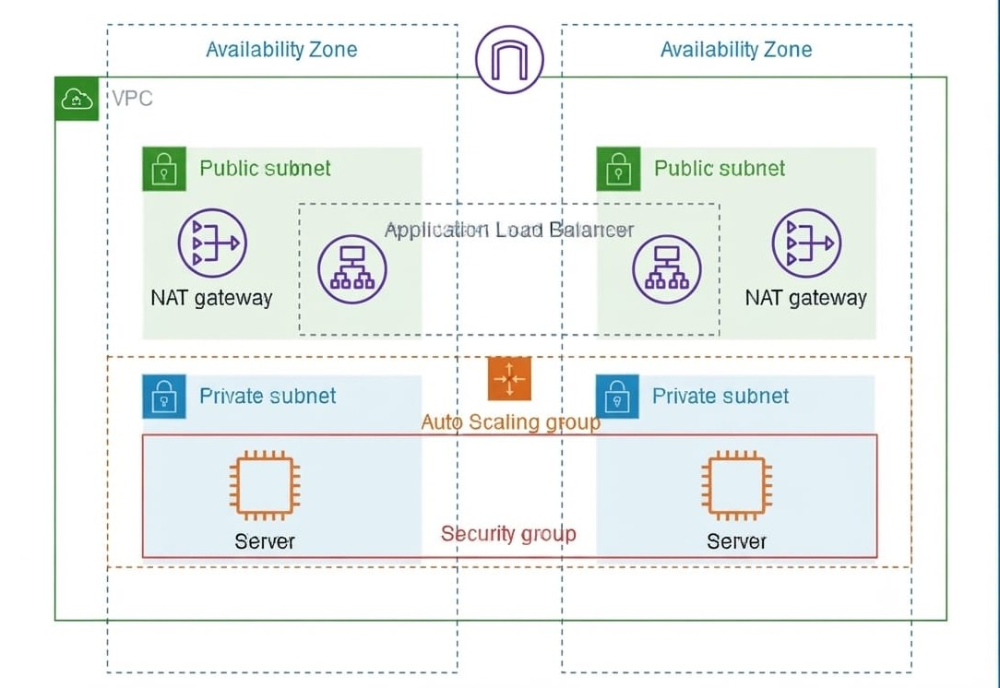

### Traffic Flows

**User request (inbound):**

```
Internet -> Internet Gateway -> Application Load Balancer (public subnets)
         -> Target Group -> EC2 instances (private subnets, Auto Scaling Group)
```

**Server to internet (outbound):**

```
EC2 (private subnet) -> NAT Gateway (same-AZ public subnet) -> Internet Gateway -> Internet
```

**Administrator access:**

```
Laptop -> Bastion host (public subnet) -> EC2 instances (private subnets)
```

### Network Layout

| Layer | AZ 1 | AZ 2 |
|---|---|---|
| Public subnet | ALB node, NAT Gateway, Bastion host | ALB node, NAT Gateway |
| Private subnet | EC2 application instance | EC2 application instance |

---

## 3. Design Decisions

| Decision | Reasoning |
|---|---|
| **Two Availability Zones** | Keeps the application available if one AZ has an outage |
| **Application servers in private subnets** | No public IPs, so they cannot be reached directly from the internet |
| **NAT Gateway in each AZ** | Removes the single point of failure and avoids cross-AZ NAT traffic |
| **ALB in public subnets** | Single controlled entry point; supports health checks and Layer 7 routing |
| **Auto Scaling Group + Launch Template** | Self-healing and consistent instance configuration; can scale on demand |
| **Bastion host** | Central place to control and audit administrative SSH access |
| **`t3.micro` instances** | Cost-efficient for a proof of concept |

---

## 4. Technologies Used

| Category | Service / Tool |
|---|---|
| Networking | VPC, Subnets, Route Tables, Internet Gateway, NAT Gateway, Elastic IP |
| Compute | EC2 (`t3.micro`), Launch Template, Auto Scaling Group |
| Load Balancing | Application Load Balancer, Target Group, Health Checks |
| Security | Security Groups, Key Pairs, Bastion host |
| Application | Python 3 (`http.server`), HTML |
| OS / Tools | Ubuntu Linux, SSH, SCP |

---

## 5. Resource Configuration

| Resource | Configuration |
|---|---|
| VPC name | `aws-prod-project` |
| Availability Zones | 2 |
| Public subnets | 2 (one per AZ) |
| Private subnets | 2 (one per AZ) |
| NAT Gateways | 1 per AZ (2 total) |
| VPC endpoints | None |
| IPv6 | Not used |
| Instance type | `t3.micro` |
| Operating system | Ubuntu |
| Application port | 8000 |
| Load balancer type | Application Load Balancer (internet-facing) |
| Listener | HTTP : 80 |
| Auto Scaling | Desired capacity 2 (one instance per private subnet) |

---

## 6. Implementation Walkthrough

### Step 1: Create the VPC

Created the network using **VPC and more** in the VPC console with the following settings:

| Setting | Value |
|---|---|
| Name tag | `aws-prod-project` |
| Availability Zones | 2 |
| Public subnets | 2 |
| Private subnets | 2 |
| NAT Gateways | 1 per AZ |
| VPC endpoints | None |

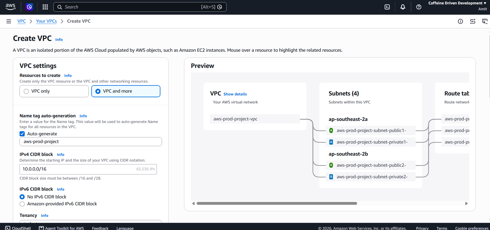

---

### Step 2: Verify VPC Resource Map, Subnets, and Gateways

Confirmed that all network components were created and connected correctly:

- **Subnets:** 2 public + 2 private, one of each per AZ
- **Public route table:** `0.0.0.0/0` to the Internet Gateway
- **Private route tables:** `0.0.0.0/0` to the NAT Gateway in the same AZ
- **Internet Gateway:** attached to the VPC
- **NAT Gateways:** both in the **Available** state, each with an Elastic IP

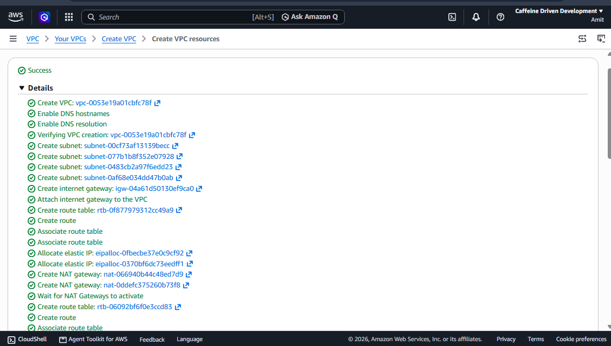


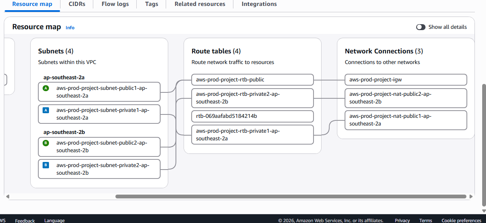


---

### Step 3: Create the Launch Template

Defined a reusable instance configuration for the Auto Scaling Group.

| Setting | Value |
|---|---|
| Name | `aws-prod-project` |
| AMI | Ubuntu |
| Instance type | `t3.micro` |
| Key pair | Existing key pair |
| Security group | Created inside the `aws-prod-project` VPC (SSH 22, App 8000) |


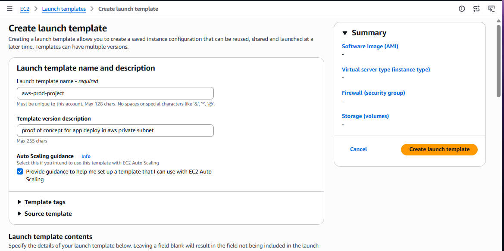
---

### Step 4: Create the Auto Scaling Group

Deployed the application servers across both **private subnets**.

| Setting | Value |
|---|---|
| Name | `aws-prod-project` |
| VPC | `aws-prod-project` |
| Subnets | Private subnet in AZ 1 and private subnet in AZ 2 |
| Desired / Min capacity | 2 |
| Load balancer | Attached later through the Target Group |

Verified that two instances launched, one in each AZ, with **no public IP**.

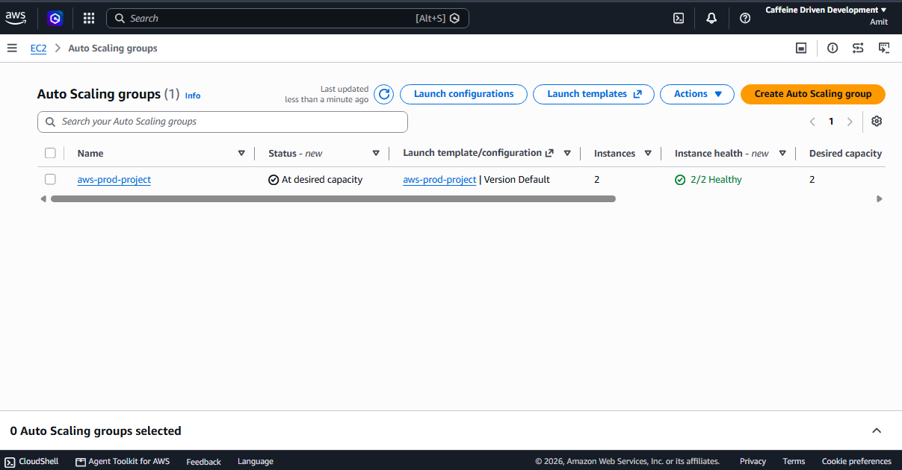


---

### Step 5: Launch the Bastion Host

Because the application instances have no public IP, a Bastion host was launched in a **public subnet** of the same VPC with an auto-assigned public IP.

| Setting | Value |
|---|---|
| Name | `Bastion-Host` |
| Instance type | `t3.micro` |
| VPC / Subnet | `aws-prod-project` / public subnet |
| Auto-assign public IP | Enabled |
| Inbound rule | SSH (22) |

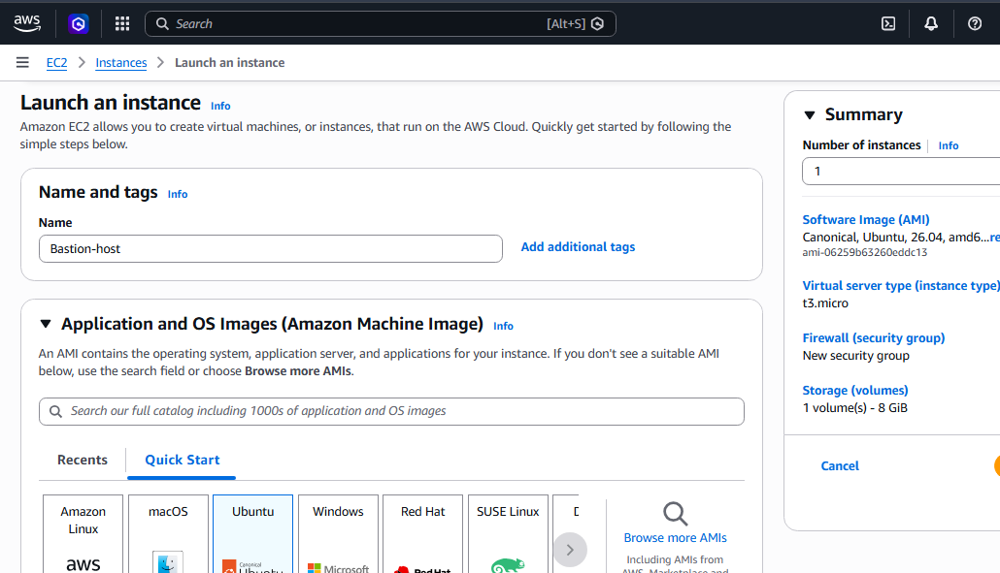

---

### Step 6: Connect to the Private Instances Through the Bastion

Copied the key pair to the Bastion, logged in, then connected to a private instance using its private IP.

```bash
# From my laptop: copy the key to the Bastion
scp -i <key>.pem <key>.pem ubuntu@<BASTION_PUBLIC_IP>:~

# Connect to the Bastion
ssh -i <key>.pem ubuntu@<BASTION_PUBLIC_IP>

# From the Bastion: connect to a private instance
ssh -i <key>.pem ubuntu@<PRIVATE_INSTANCE_IP>

```
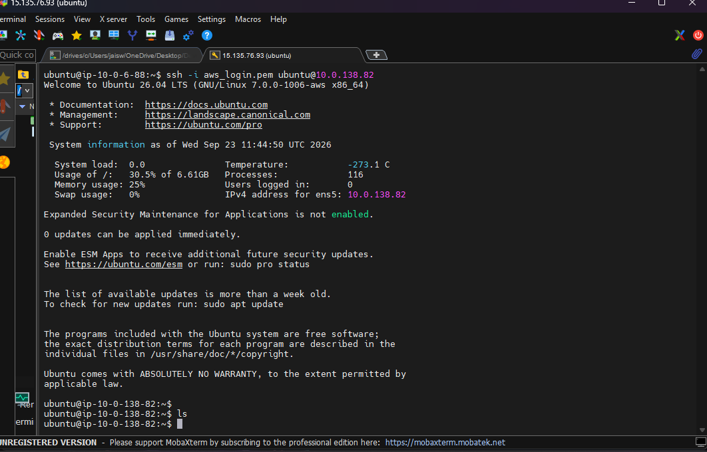
---

### Step 7: Deploy the Application

Created a simple HTML page on the private instance and served it on port `8000`.

```bash
nano index.html
python3 -m http.server 8000
```

---

### Step 8: Create the Target Group

| Setting | Value |
|---|---|
| Name | `aws-prod-project` |
| Target type | Instances |
| Protocol : Port | HTTP : 8000 |
| VPC | `aws-prod-project` |
| Health check | HTTP |
| Registered targets | Both private instances |


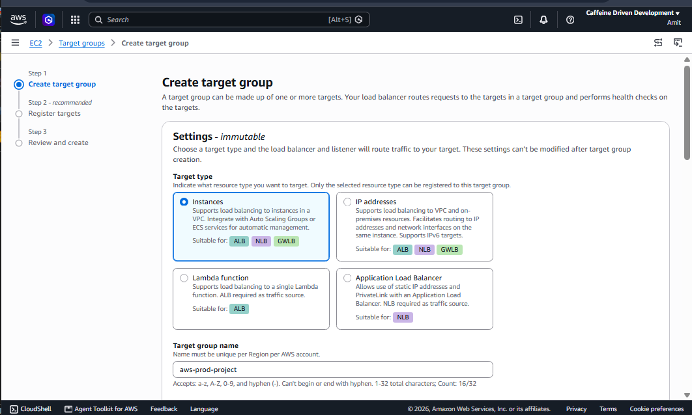

---

### Step 9: Create the Application Load Balancer

| Setting | Value |
|---|---|
| Name | `aws-prod-project` |
| Scheme | Internet-facing |
| IP type | IPv4 |
| VPC | `aws-prod-project` |
| Subnets | Both **public** subnets (2 AZs) |
| Listener | HTTP : 80 forwarding to the target group |

Waited for the load balancer to reach the **Active** state.


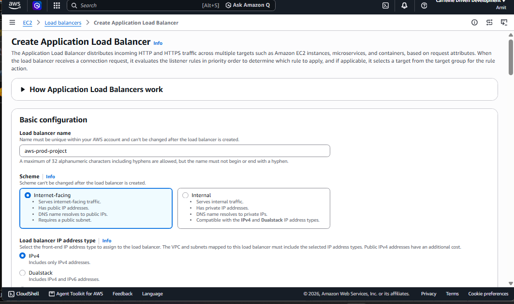

---

### Step 10: Configure the Security Group for the Load Balancer

Allowed inbound **HTTP (port 80)** from the internet on the load balancer's security group so users can reach the listener.

---

## 7. Verification and Testing

### 7.1 Application accessible through the Load Balancer

Opened the ALB DNS name in a browser and received the page hosted on the private instance.

```
https://aws-prod-project-202985942.ap-southeast-2.elb.amazonaws.com/
```

### 7.2 Target health

Verified target health in the Target Group. The ALB only forwards traffic to **healthy** targets.

### 7.3 Load Distribution Across Availability Zones

Deployed a different page on each instance and refreshed the ALB URL to confirm requests are distributed between both AZs.

#### Availability Zone 1

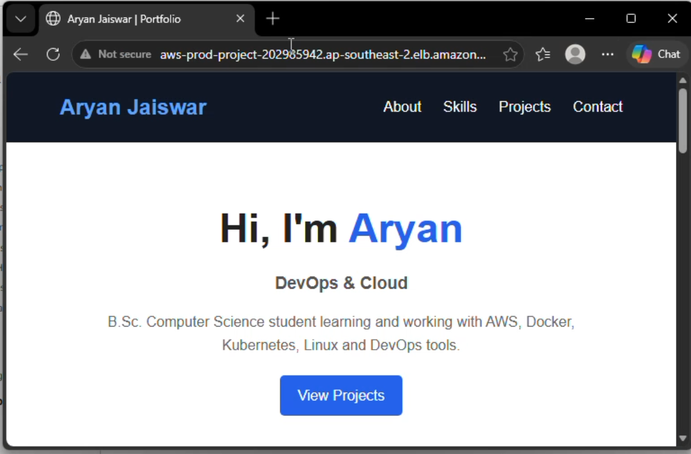

#### Availability Zone 2

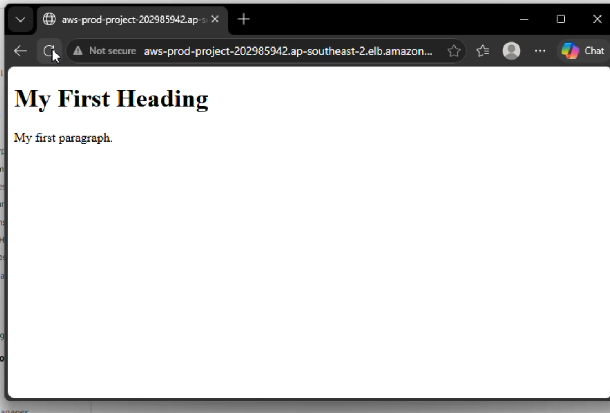

---

## 8. Challenges and Solutions

| Challenge | Root cause | Solution |
|---|---|---|
| ALB DNS name was not reachable | Security group did not allow HTTP on the listener port | Added an inbound HTTP (80) rule |
| Targets showed as unhealthy | Target group port did not match the application port, or app was not running on that instance | Recreated the target group on port 8000 and started the app |
| Private instances unreachable over SSH | No public IP by design | Used the Bastion host as a jump server |

---

## 9. Security Considerations

- Application instances are in **private subnets** with **no public IPs**.
- Users can only reach the application through the **Application Load Balancer**.
- **NAT Gateways** allow outbound traffic only, so server IP addresses stay hidden from external services.
- Administrative access is funneled through a single **Bastion host**.
- Security groups restrict traffic to only the required ports (22, 80, 8000).

---

## 10. Future Improvements

- Restrict SSH to a specific IP and allow port 8000 **only from the ALB security group**
- Replace stored key copies on the Bastion with **SSH agent forwarding / ProxyJump** or **AWS Systems Manager Session Manager**
- Add **HTTPS** using an ACM certificate on the ALB
- Add **target-tracking scaling policies** based on CPU utilization
- Add **CloudWatch alarms and dashboards** and enable **VPC Flow Logs**
- Automate the whole setup with **Terraform** or **CloudFormation**
- Replace `python3 -m http.server` with **Nginx** or a production WSGI server

---

## 11. Cleanup

NAT Gateways and Elastic IPs are billed, so resources were removed in this order:

1. Load Balancer
2. Target Group
3. Auto Scaling Group (terminates its instances)
4. Bastion host
5. Launch Template
6. VPC (removes subnets, route tables, Internet Gateway, NAT Gateways)
7. Release remaining Elastic IPs

---

## 12. Key Learnings

- Designing a multi-AZ VPC with public and private subnet tiers
- How route tables, Internet Gateways, and NAT Gateways work together
- Hosting applications privately and exposing them safely through an ALB
- Using Launch Templates and Auto Scaling Groups for resilience
- How target group health checks control traffic routing
- Securing administrative access with a Bastion host
- Troubleshooting security group, port, and health check issues

---

## 13. Author

**Aryan Jaiswar**  
**GitHub: [https://github.com/iam-aryanjaiswar](https://github.com/iam-aryanjaiswar)   
LinkedIn: [https://www.linkedin.com/in/aryan-jaiswar/](https://www.linkedin.com/in/aryan-jaiswar/)**

---
